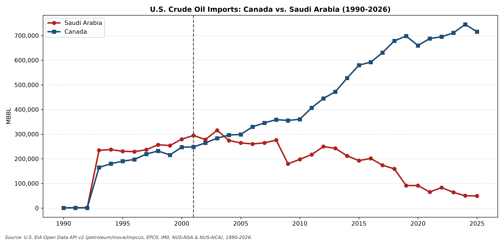
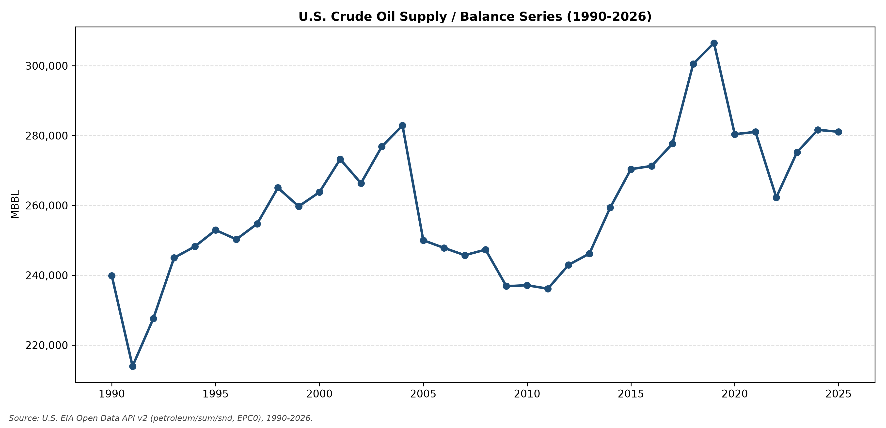
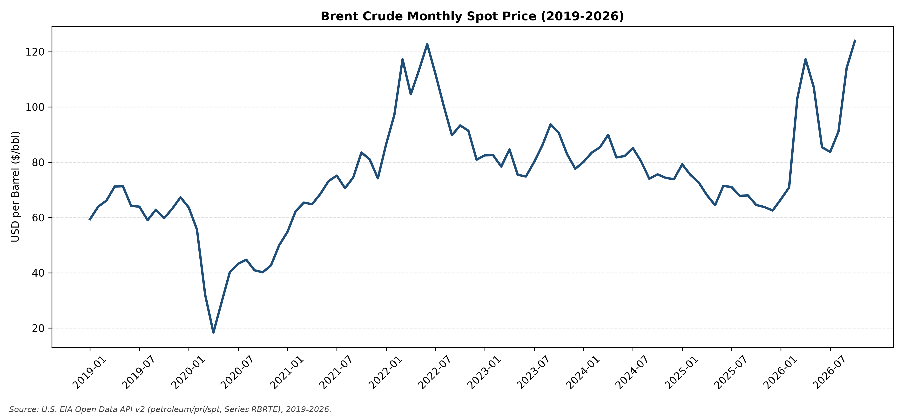
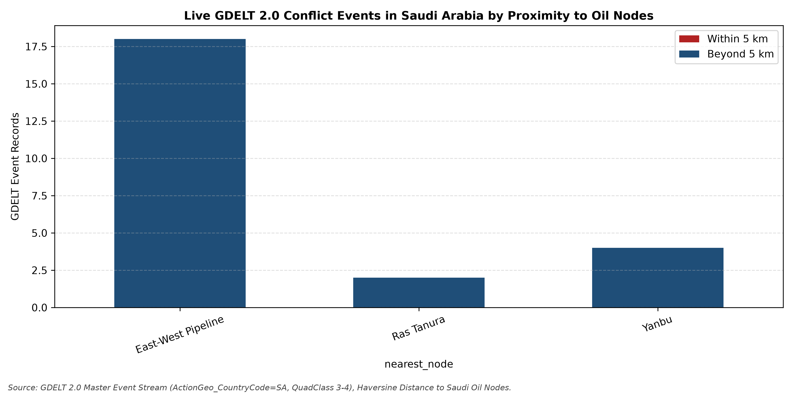
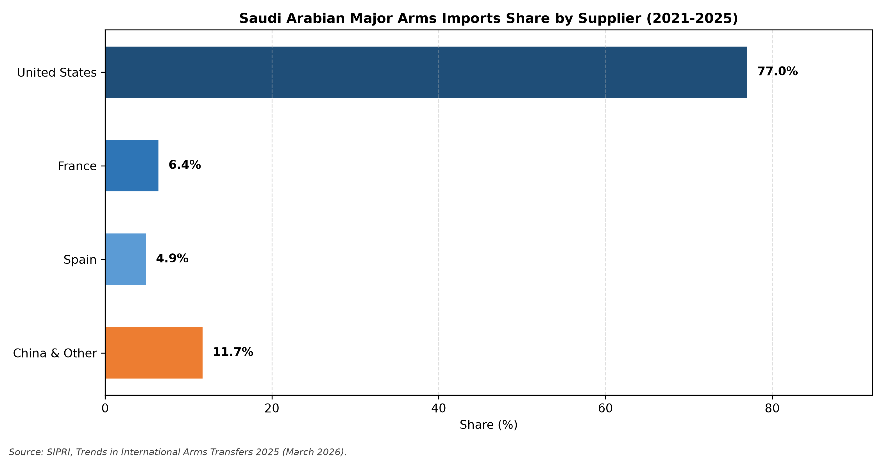

# U.S.-Saudi Energy Security, Infrastructure Risk & Oil-for-Arms Decoupling

> Quantitative OSINT and energy policy repository examining U.S. crude oil independence, Canadian import displacement, kinetic strike proximity to Saudi oil infrastructure, and strain on the traditional U.S.-Saudi security bargain.

**Navigation:** [Laws & Congressional Actions ->](Laws-and-Congressional-Actions.md) · [OSINT & Data Methodology ->](Methodology-and-OSINT-Risk.md) · [Pipeline Script](scripts/update_pipeline.py)

---

## Executive Key Findings

> **Core Thesis:** As U.S. crude supply independence has grown and Saudi Arabia has hedged toward non-U.S. partners, the traditional U.S.-Saudi energy and security partnership faces rising structural strain—even as Saudi oil infrastructure remains critical to global price stability.

- **U.S. Crude Shift & Import Displacement:** Canada overtook Saudi Arabia in U.S. crude oil imports (reaching 1.79M b/d by 2001), and the U.S. shifted to a net energy/crude exporter by 2019—reducing physical U.S. reliance on Saudi crude access even though supply shocks still affect global prices.
- **Kinetic Risk Near Oil Infrastructure:** ACLED data shows heightened conflict exposure in Saudi Arabia, including 305 foreign military engagements over the past year and 52 of 123 attacks between July and October 2026 occurring within 5 km of oil facilities, with direct hits on infrastructure like the East-West pipeline driving sharp oil price reactions.
- **Asymmetric Arms Dependency vs. Hedging:** The U.S. accounts for 77% of Saudi Arabia's arms imports (as of 2025), creating deep operational reliance on U.S. equipment and sustainment, while Saudi Arabia exports 14.4% to China, engages with BRI/BRICS, settles some oil trades in RMB, and ended unconditional production appeasement.

---

## Strategic Analysis: What Happened, What It Means & Where We Are Going

<strong>Click to Expand: Policy, Market & Security Thesis</strong>

 

### 1. What Happened
Since the 1970s oil shocks, U.S. reliance on Middle Eastern crude has steadily declined as Canadian imports expanded and U.S. domestic production surged to net-exporter status around 2019. Simultaneously, Saudi Arabia has diversified economic and diplomatic ties—most notably with China—and moved away from automatic oil output accommodation, while facing recurring drone, missile, and maritime threats affecting chokepoints and energy facilities.

### 2. What It Means
A disruption to Saudi infrastructure or chokepoints like Hormuz and Bab Al-Mandeb still moves global crude prices and can carry a steep geopolitical risk premium, yet physical U.S. crude access is far less vulnerable than in prior decades. Meanwhile, U.S. voters and lawmakers have grown more skeptical of open-ended Middle East military entanglement, creating friction over requests for U.S. security backing and arms transfers.

### 3. Where We Are Going
Both staying the course and pulling back carry costs: maintaining security commitments while Riyadh hedges with U.S. competitors risks paying to underwrite declining U.S. influence, whereas rapid or broad security withdrawal risks widening defense/sustainment gaps in Saudi Arabia and triggering higher oil price volatility and pump-price backlash at home.

---

## 1. U.S. Crude Imports: Saudi Arabia vs. Canada

<strong>Click to Expand: Chart & Dataset (1990-2026)</strong>

 

- **Data File:** `Data-Spreadsheets/US-Crude-Imports-Saudi-vs-Canada-1990-2026.csv`

---

## 2. U.S. Total Crude Net Imports & Net-Exporter Shift

<strong>Click to Expand: Chart & Dataset (1990-2026)</strong>

 

- **Data File:** `Data-Spreadsheets/US-Total-Crude-Net-Imports-1990-2026.csv`

---

## 3. Brent Crude Spot Prices & Shock Timeline

<strong>Click to Expand: Chart & Dataset (2019-2026)</strong>

 

- **Data File:** `Data-Spreadsheets/Brent-Crude-Monthly-Spot-Prices-2019-2026.csv`

---

## 4. ACLED Kinetic Events & Proximity to Saudi Oil Infrastructure

<strong>Click to Expand: Chart & Dataset (2019-2026)</strong>

 

- **Data File:** `Data-Spreadsheets/ACLED-Saudi-Kinetic-Events-2019-2026.csv`

---

## 5. SIPRI Saudi Arms Import Dependency

<strong>Click to Expand: Chart & Dataset (2021-2025)</strong>

 

- **Data File:** `Data-Spreadsheets/SIPRI-Saudi-Arms-Imports-Share-2021-2025.csv`

