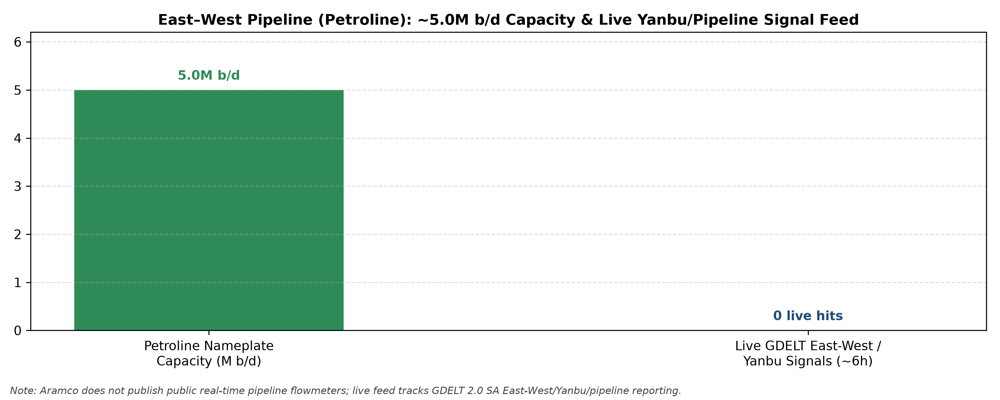
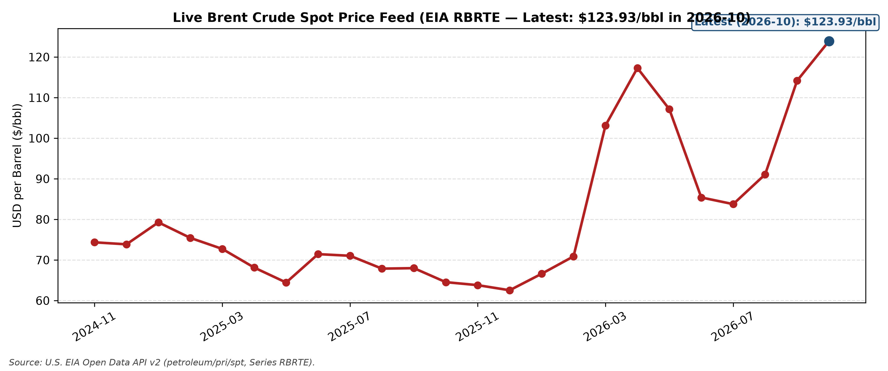
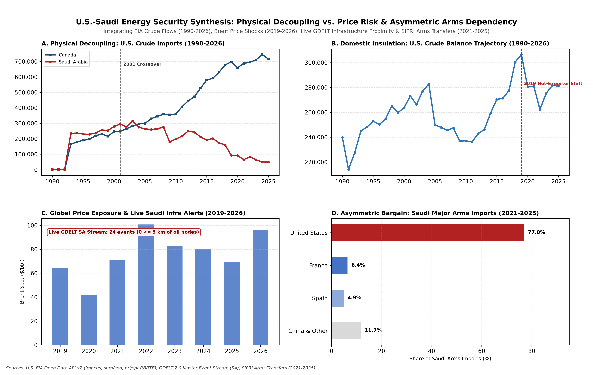
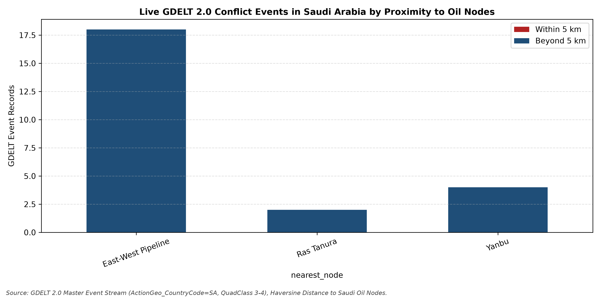
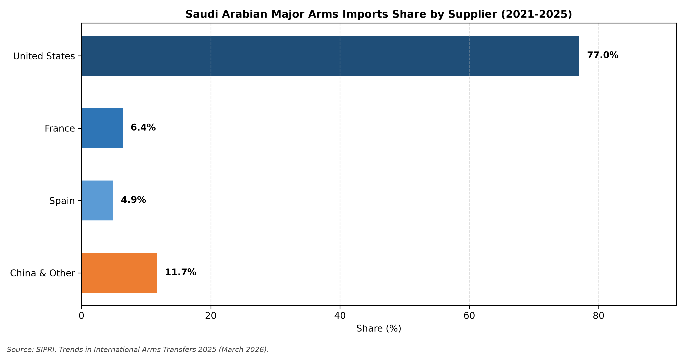

# U.S.-Saudi Energy Security, Infrastructure Risk & Oil-for-Arms Decoupling

> Quantitative OSINT and energy policy repository examining U.S. crude oil independence, Canadian import displacement, kinetic strike proximity to Saudi oil infrastructure, and strain on the traditional U.S.-Saudi security bargain.

**Navigation:** [Laws & Congressional Actions →](Laws-and-Congressional-Actions.md) · [OSINT & Data Methodology →](Methodology-and-OSINT-Risk.md) · [Pipeline Script](scripts/update_pipeline.py)

---

## 1. Live Tanker Feeds: Red Sea Side vs. Persian Gulf Side

### Red Sea Side (Yanbu Terminal)

<iframe name="vesselfinder_redsea" id="vesselfinder_redsea" width="100%" height="420" frameborder="0" src="https://www.vesselfinder.com/aismap?zoom=9&lat=23.99&lon=38.22&width=100%25&height=420&names=false&mmsi=0&imo=0&track=false&fleet=&fleet_name=&fleet_timespan=1440&fleet_hide_old_positions=false&clicktoact=false&store_pos=true&ra=false">Red Sea AIS feed unavailable; open VesselFinder directly.</iframe>

### Persian Gulf Side (Ras Tanura & Ju'aymah)

<iframe name="vesselfinder_gulf" id="vesselfinder_gulf" width="100%" height="420" frameborder="0" src="https://www.vesselfinder.com/aismap?zoom=8&lat=26.64&lon=50.16&width=100%25&height=420&names=false&mmsi=0&imo=0&track=false&fleet=&fleet_name=&fleet_timespan=1440&fleet_hide_old_positions=false&clicktoact=false&store_pos=true&ra=false">Persian Gulf AIS feed unavailable; open VesselFinder directly.</iframe>

---

## 2. Live East–West Pipeline (Petroline) Flows & Telemetry Feed

> **East–West Pipeline Takeaway:** Saudi Arabia's East–West Pipeline (Petroline) carries crude from the Eastern Province to Yanbu on the Red Sea (~5.0M b/d nameplate capacity). Because live SCADA flowmeter telemetry is not publicly released, this feed pairs capacity benchmarks with live GDELT 2.0 reporting on Yanbu, East–West, and pipeline activity.

- **Live Feed Data File:** `Data-Spreadsheets/East-West-Pipeline-Live-Feed.csv`

---

## 3. Quad 4: Live Oil Pricing (Brent Crude Spot Feed)

> **Live Pricing Takeaway:** Live Brent crude spot prices from the U.S. EIA Open Data API v2 track real-time global benchmark movements alongside Saudi export corridor activity and geopolitical risk signals.

- **Live Pricing Data File:** `Data-Spreadsheets/Live-Brent-Crude-Pricing.csv`

---

## 4. Master Synthesis: Connecting Crude Independence, Price Risk & Arms Asymmetry

> **Synthesis Takeaway:** Taken together, these indicators expose the core asymmetry of the contemporary U.S.–Saudi bargain: while U.S. physical reliance on Saudi crude declined after 2001 and net-exporter shifts reduced physical import vulnerability, global oil prices remain exposed to threats around Saudi energy nodes—even as Riyadh relies on Washington for 77% of its major arms imports.

- **Unified Master Dataset:** `Data-Spreadsheets/Master-US-Saudi-Security-Matrix.csv`

---

## 5. U.S. Crude Imports: Saudi Arabia vs. Canada (Barrels)

> **Analytical Takeaway:** Canadian crude imports overtook Saudi shipments by 2001 and steadily displaced Gulf barrels in U.S. refineries, fundamentally eroding Saudi Arabia's bilateral leverage over physical U.S. supply security.

- **Data File:** `Data-Spreadsheets/US-Crude-Imports-Saudi-vs-Canada-1990-2026.csv`

---

## 6. U.S. Total Crude Net Imports & Net-Exporter Shift (Barrels)

> **Analytical Takeaway:** The U.S. structural shift toward net crude/energy exporter status insulated domestic physical availability from Middle Eastern supply disruptions, even though U.S. fuel prices remain tied to global benchmark crude markets.

- **Data File:** `Data-Spreadsheets/US-Total-Crude-Balance-1990-2026.csv`

---

## 7. Brent Crude Spot Prices & Shock Timeline

> **Analytical Takeaway:** Major geopolitical flashpoints and regional chokepoint threats rapidly inject risk premia into global Brent crude benchmarks, demonstrating that physical U.S. import independence does not shield Washington from global oil price volatility.

- **Data File:** `Data-Spreadsheets/Brent-Crude-Monthly-Spot-Prices-2019-2026.csv`

---

## 8. Live GDELT Reporting & Proximity to Saudi Oil Infrastructure

> **Analytical Takeaway:** Kinetic and security incidents clustered near core Saudi oil infrastructure—including Abqaiq, Ras Tanura, Yanbu, Shaybah, and the East–West Pipeline—highlight persistent physical vulnerability at high-throughput nodes capable of moving global prices.

- **Data File:** `Data-Spreadsheets/Live-GDELT-Saudi-Oil-Infra-Proximity.csv`

---

## 9. SIPRI Saudi Arms Import Dependency

> **Analytical Takeaway:** With the United States supplying 77.0% of Saudi major arms transfers (2021–2025), Riyadh faces deep operational and sustainment dependence on U.S. defense platforms even as it hedges diplomatically and commercially toward non-U.S. partners.

- **Data File:** `Data-Spreadsheets/SIPRI-Saudi-Arms-Imports-Share-2021-2025.csv`
