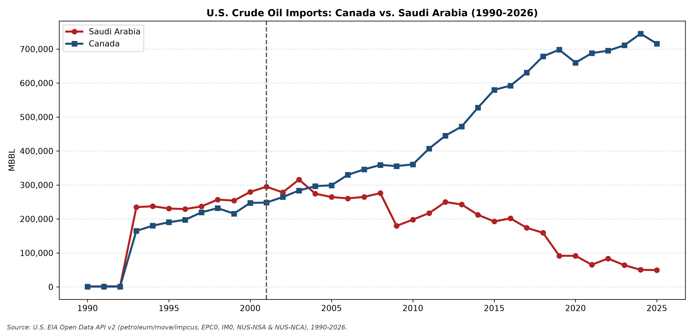
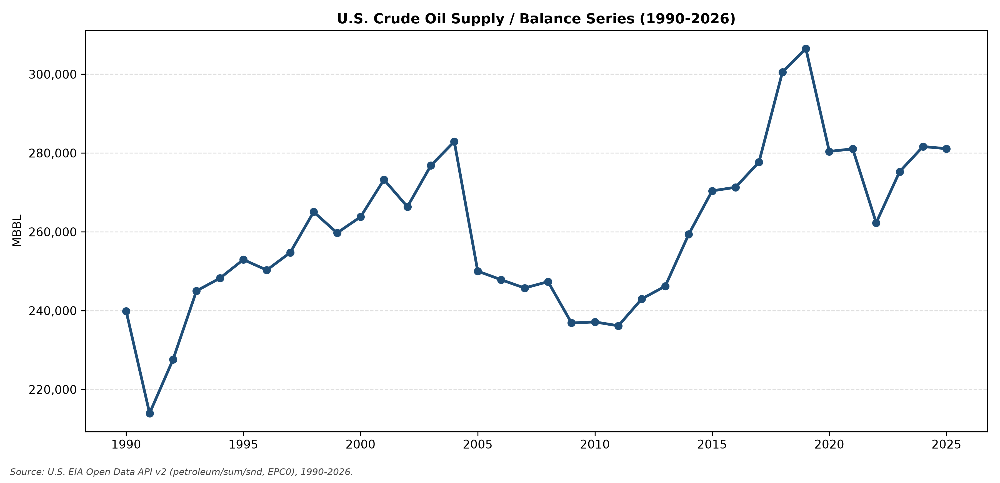
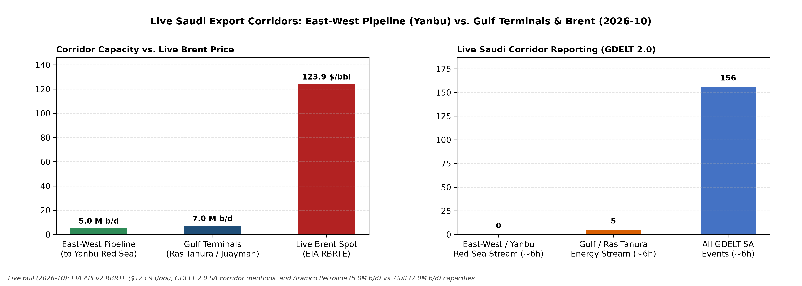

<!DOCTYPE html>
<html lang="en">
<head>
  <meta charset="UTF-8" />
  <meta name="viewport" content="width=device-width, initial-scale=1.0" />
  <title>U.S.–Saudi Energy Security, Infrastructure Risk &amp; Oil-for-Arms Decoupling</title>
  
</head>
<body>

<header>
  

    OSINT &amp; Energy Security Monitor
    <h1>U.S.–Saudi Energy Security, Infrastructure Risk &amp; Oil-for-Arms Decoupling</h1>
    
Quantitative OSINT and energy policy dashboard tracking Saudi maritime export corridors, U.S. crude oil independence, kinetic proximity to energy infrastructure, and asymmetric arms dependency.

    <nav>
      <a href="https://github.com/junothedudepathsofgloryrye/Saudi-American-Energy-Relationship">GitHub Repository</a>
      <a href="Laws-and-Congressional-Actions.html">Laws &amp; Congressional Actions</a>
      <a href="Methodology-and-OSINT-Risk.html">OSINT &amp; Data Methodology</a>
      <a href="https://github.com/junothedudepathsofgloryrye/Saudi-American-Energy-Relationship/blob/main/scripts/update_pipeline.py">Pipeline Script</a>
    </nav>
  

</header>

<main class="container">

  <!-- 2x2 TOP COMMAND QUAD -->
  <section class="quad-grid">

    <!-- QUAD 1: RED SEA TANKER FEED -->
    

      

        <h2>1. Red Sea Tanker Feed — Yanbu Export Terminal</h2>
        Live AIS
      

      

        <iframe name="vesselfinder_redsea" src="https://www.vesselfinder.com/aismap?zoom=9&amp;lat=23.99&amp;lon=38.22&amp;width=100%25&amp;height=360&amp;names=false&amp;mmsi=0&amp;imo=0&amp;track=false&amp;fleet=&amp;fleet_name=&amp;fleet_timespan=1440&amp;fleet_hide_old_positions=false&amp;clicktoact=false&amp;store_pos=true&amp;ra=false"></iframe>
      

    

    <!-- QUAD 2: PERSIAN GULF TANKER FEED -->
    

      

        <h2>2. Persian Gulf Tanker Feed — Ras Tanura &amp; Ju&rsquo;aymah</h2>
        Live AIS
      

      

        <iframe name="vesselfinder_gulf" src="https://www.vesselfinder.com/aismap?zoom=8&amp;lat=26.64&amp;lon=50.16&amp;width=100%25&amp;height=360&amp;names=false&amp;mmsi=0&amp;imo=0&amp;track=false&amp;fleet=&amp;fleet_name=&amp;fleet_timespan=1440&amp;fleet_hide_old_positions=false&amp;clicktoact=false&amp;store_pos=true&amp;ra=false"></iframe>
      

    

    <!-- QUAD 3: LIVE EAST-WEST PIPELINE TELEMETRY -->
    

      

        <h2>3. East–West Pipeline (Petroline) Live Corridor Feed</h2>
        Telemetry + GDELT
      

      

        

          
Abqaiq &rarr; Yanbu Red Sea Bypass Nameplate Capacity

          
5.00M bbl/day

          

          

            

              
Pipeline Length

              
1,200 km

            

            

              
Gulf Terminal Cap

              
7.00M b/d

            

            

              
Live SA Signals

              
Loading…

            

          

        

        <ul class="feed-list" id="ew-feed">
          <li>Syncing live GDELT 2.0 Yanbu / East–West / pipeline stream…</li>
        </ul>
      

    

    <!-- QUAD 4: LIVE OIL PRICING -->
    

      

        <h2>4. Live Oil Pricing — ICE / EIA Brent Crude Spot</h2>
        EIA API v2
      

      

        

          
Global Seaborne Benchmark (Series RBRTE)

          
$—.— / bbl

          

            

              
Latest Period

              
—

            

            

              
Prior Period

              
—

            

            

              
Period Delta

              
—

            

          

        

        <svg id="brent-spark" viewBox="0 0 420 95" style="width:100%; height:95px; margin-top:0.85rem; background:#0f172a; border:1px solid #334155; border-radius:8px;"></svg>
      

    

  </section>

  <!-- 4-LINE SAUDI PIPELINE, PORT & TANKER INCIDENT GRAPHIC -->
  <section class="incident-panel">
    

      <h2>Recent Saudi Pipeline, Port &amp; Tanker Security Incidents (Latest 4 Events)</h2>
      GDELT 2.0 + Corridor Log
    

    

      
Syncing…FEEDSaudi Energy NodesLoading latest 4 pipeline, port, and Saudi-linked tanker reports…—

    

  </section>

  <!-- MASTER SYNTHESIS -->
  <section class="section-card">
    <h2>Master Synthesis: Connecting Crude Independence, Price Risk &amp; Arms Asymmetry</h2>
    
    
<strong>Synthesis Takeaway:</strong> Taken together, these four indicators expose the core asymmetry of the contemporary U.S.–Saudi bargain: while U.S. physical reliance on Saudi crude declined after 2001 and net-exporter shifts reduced physical import vulnerability, global oil prices remain exposed to threats around Saudi energy nodes—even as Riyadh relies on Washington for 77% of its major arms imports.

    
Unified Master Dataset: <code>Data-Spreadsheets/Master-US-Saudi-Security-Matrix.csv</code>

  </section>

  <!-- CHART 1 -->
  <section class="section-card">
    <h2>1. U.S. Crude Imports: Saudi Arabia vs. Canada (Barrels)</h2>
    
    
<strong>Analytical Takeaway:</strong> Canadian crude imports overtook Saudi shipments by 2001 and steadily displaced Gulf barrels in U.S. refineries, fundamentally eroding Saudi Arabia&rsquo;s bilateral leverage over physical U.S. supply security.

    
Data File: <code>Data-Spreadsheets/US-Crude-Imports-Saudi-vs-Canada-1990-2026.csv</code>

  </section>

  <!-- CHART 2 -->
  <section class="section-card">
    <h2>2. U.S. Total Crude Net Imports &amp; Net-Exporter Shift (Barrels)</h2>
    
    
<strong>Analytical Takeaway:</strong> The U.S. structural shift toward net crude/energy exporter status insulated domestic physical availability from Middle Eastern supply disruptions, even though U.S. fuel prices remain tied to global benchmark crude markets.

    
Data File: <code>Data-Spreadsheets/US-Total-Crude-Balance-1990-2026.csv</code>

  </section>

  <!-- CHART 3 -->
  <section class="section-card">
    <h2>3. Brent Crude Spot Prices &amp; Shock Timeline</h2>
    
    
<strong>Analytical Takeaway:</strong> Major geopolitical flashpoints and regional chokepoint threats rapidly inject risk premia into global Brent crude benchmarks, demonstrating that physical U.S. import independence does not shield Washington from global oil price volatility.

    
Data File: <code>Data-Spreadsheets/Brent-Crude-Monthly-Spot-Prices-2019-2026.csv</code>

  </section>

  <!-- CHART 4 -->
  <section class="section-card">
    <h2>4. Live GDELT Reporting &amp; Proximity to Saudi Oil Infrastructure</h2>
    
    
<strong>Analytical Takeaway:</strong> Saudi Arabia balances Gulf seaborne exports at Ras Tanura and Ju&rsquo;aymah (~7.0M b/d) against its 1,200 km East–West Pipeline (Petroline) outlet to Yanbu on the Red Sea (~5.0M b/d), linking physical maritime tanker flows directly to global Brent price sensitivity.

    
Data File: <code>Data-Spreadsheets/Live-GDELT-Saudi-Oil-Infra-Proximity.csv</code>

  </section>

  <!-- CHART 5 -->
  <section class="section-card">
    <h2>5. SIPRI Saudi Arms Import Dependency</h2>
    
    
<strong>Analytical Takeaway:</strong> With the United States supplying 77.0% of Saudi major arms transfers (2021–2025), Riyadh faces deep operational and sustainment dependence on U.S. defense platforms even as it hedges diplomatically and commercially toward non-U.S. partners.

    
Data File: <code>Data-Spreadsheets/SIPRI-Saudi-Arms-Imports-Share-2021-2025.csv</code>

  </section>

</main>

<footer>
  Saudi-American-Energy-Relationship &middot; Live OSINT, EIA v2, GDELT 2.0 &amp; SIPRI Analytical Dashboard
</footer>

</body>
</html>
