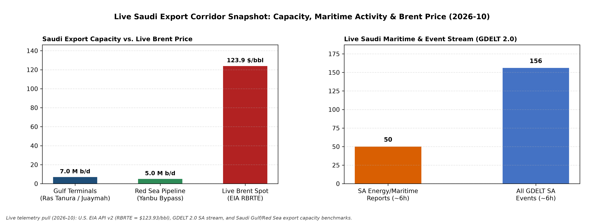
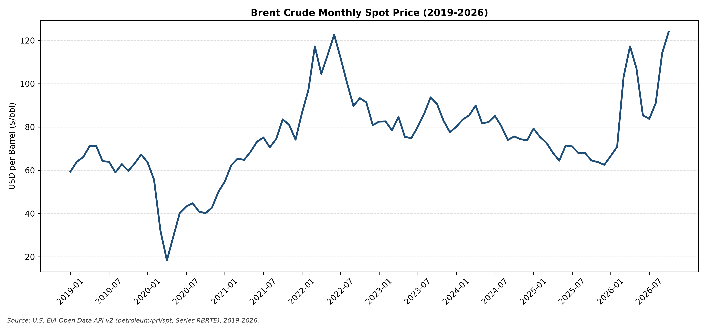

# U.S.-Saudi Energy Security, Infrastructure Risk & Oil-for-Arms Decoupling

> Quantitative OSINT and energy policy repository examining U.S. crude oil independence, Canadian import displacement, kinetic strike proximity to Saudi oil infrastructure, and strain on the traditional U.S.-Saudi security bargain.

**Navigation:** [Laws & Congressional Actions ->](Laws-and-Congressional-Actions.md) · [OSINT & Data Methodology ->](Methodology-and-OSINT-Risk.md) · [Pipeline Script](scripts/update_pipeline.py)

---

## Live Saudi Export Corridor, Maritime Activity & Brent Price

> **Live Saudi Market & Shipping Takeaway:** Saudi Arabia balances Gulf export terminals (Ras Tanura and Ju'aymah) against its Red Sea East–West pipeline outlet at Yanbu, while live Brent crude pricing and real-time Saudi maritime reporting track how physical export flows and security signals translate into global oil market pressure.

- **Live Telemetry Data File:** `Data-Spreadsheets/Live-Saudi-Shipping-Capacity-Brent.csv`

## Live Saudi Export Corridor, Maritime Activity & Brent Price

> **Live Saudi Market & Shipping Takeaway:** Saudi Arabia balances Gulf export terminals (Ras Tanura and Ju'aymah) against its Red Sea East–West pipeline outlet at Yanbu, while live Brent crude pricing and real-time Saudi maritime reporting track how physical export flows and security signals translate into global oil market pressure.

- **Live Telemetry Data File:** `Data-Spreadsheets/Live-Saudi-Shipping-Capacity-Brent.csv`

### Live AIS Tankers Near Saudi Export Terminals (Ras Tanura & Persian Gulf)

<iframe name="vesselfinder_saudi" id="vesselfinder_saudi" width="100%" height="460" frameborder="0" src="https://www.vesselfinder.com/aismap?zoom=8&lat=26.64&lon=50.16&width=100%25&height=460&names=false&mmsi=0&imo=0&track=false&fleet=&fleet_name=&fleet_timespan=1440&fleet_hide_old_positions=false&clicktoact=false&store_pos=true&ra=false">Live AIS map requires an iframe-capable browser. Visit <a href="https://www.vesselfinder.com" target="_blank">www.vesselfinder.com</a>.</iframe>

---

## Executive Key Findings

> **Core Thesis:** As U.S. crude supply independence has grown and Saudi Arabia has hedged toward non-U.S. partners, the traditional U.S.-Saudi energy and security partnership faces rising structural strain—even as Saudi oil infrastructure remains critical to global price stability.

- **U.S. Crude Shift & Import Displacement:** Canada overtook Saudi Arabia in U.S. crude oil imports (reaching 1.79M b/d by 2001), and the U.S. shifted to a net energy/crude exporter by 2019—reducing physical U.S. reliance on Saudi crude access even though supply shocks still affect global prices.
- **Kinetic Risk Near Oil Infrastructure:** ACLED data shows heightened conflict exposure in Saudi Arabia, including 305 foreign military engagements over the past year and 52 of 123 attacks between July and October 2026 occurring within 5 km of oil facilities, with direct hits on infrastructure like the East-West pipeline driving sharp oil price reactions.
- **Asymmetric Arms Dependency vs. Hedging:** The U.S. accounts for 77% of Saudi Arabia's arms imports (as of 2025), creating deep operational reliance on U.S. equipment and sustainment, while Saudi Arabia exports 14.4% to China, engages with BRI/BRICS, settles some oil trades in RMB, and ended unconditional production appeasement.

---

## Master Synthesis: Connecting Crude Independence, Price Risk & Arms Asymmetry

> **Synthesis Takeaway:** Taken together, these four indicators expose the core asymmetry of the contemporary U.S.–Saudi bargain: while U.S. physical reliance on Saudi crude collapsed after 2001 and domestic net-exporter status in 2019 insulated physical supply, global oil prices remain exposed to kinetic threats around Saudi energy nodes—even as Riyadh relies on Washington for 77% of its major arms imports.

- **Unified Master Dataset:** `Data-Spreadsheets/Master-US-Saudi-Security-Matrix.csv` (harmonizes EIA crude imports, U.S. crude balance, Brent spot prices, live GDELT infrastructure proximity, and SIPRI arms shares on a single annual index).

---

## Strategic Analysis: What Happened, What It Means & Where We Are Going

### 1. What Happened
Since the 1970s oil shocks, U.S. reliance on Middle Eastern crude has steadily declined as Canadian imports expanded and U.S. domestic production surged to net-exporter status around 2019. Simultaneously, Saudi Arabia has diversified economic and diplomatic ties—most notably with China—and moved away from automatic oil output accommodation, while facing recurring drone, missile, and maritime threats affecting chokepoints and energy facilities.

### 2. What It Means
A disruption to Saudi infrastructure or chokepoints like Hormuz and Bab Al-Mandeb still moves global crude prices and can carry a steep geopolitical risk premium, yet physical U.S. crude access is far less vulnerable than in prior decades. Meanwhile, U.S. voters and lawmakers have grown more skeptical of open-ended Middle East military entanglement, creating friction over requests for U.S. security backing and arms transfers.

### 3. Where We Are Going
Both staying the course and pulling back carry costs: maintaining security commitments while Riyadh hedges with U.S. competitors risks paying to underwrite declining U.S. influence, whereas rapid or broad security withdrawal risks widening defense/sustainment gaps in Saudi Arabia and triggering higher oil price volatility and pump-price backlash at home.

---

## 1. U.S. Crude Imports: Saudi Arabia vs. Canada

> **Analytical Takeaway:** Canadian crude imports overtook Saudi shipments by 2001 and steadily displaced Gulf barrels in U.S. refineries, fundamentally eroding Saudi Arabia’s bilateral leverage over physical U.S. supply security.

- **Data File:** `Data-Spreadsheets/US-Crude-Imports-Saudi-vs-Canada-1990-2026.csv`

---

## 2. U.S. Total Crude Net Imports & Net-Exporter Shift

> **Analytical Takeaway:** The U.S. structural shift toward net crude/energy exporter status around 2019 insulated domestic physical availability from Middle Eastern supply disruptions, even though U.S. fuel prices remain tied to global benchmark crude markets.

- **Data File:** `Data-Spreadsheets/US-Total-Crude-Net-Imports-1990-2026.csv`

---

## 3. Brent Crude Spot Prices & Shock Timeline

> **Analytical Takeaway:** Major geopolitical flashpoints and regional chokepoint threats rapidly inject risk premia into global Brent crude benchmarks, demonstrating that physical U.S. import independence does not shield Washington from global oil price volatility.

- **Data File:** `Data-Spreadsheets/Brent-Crude-Monthly-Spot-Prices-2019-2026.csv`

---

## 4. Live GDELT Reporting & Proximity to Saudi Oil Infrastructure

> **Analytical Takeaway:** Kinetic and security incidents clustered near core Saudi oil infrastructure—including Abqaiq, Ras Tanura, Yanbu, Shaybah, and the East–West Pipeline—highlight persistent physical vulnerability at high-throughput nodes capable of moving global prices.

- **Data File:** `Data-Spreadsheets/Live-GDELT-Saudi-Oil-Infra-Proximity.csv`

---

## 5. SIPRI Saudi Arms Import Dependency

> **Analytical Takeaway:** With the United States supplying 77.0% of Saudi major arms transfers (2021–2025), Riyadh faces deep operational and sustainment dependence on U.S. defense platforms even as it hedges diplomatically and commercially toward non-U.S. partners.

- **Data File:** `Data-Spreadsheets/SIPRI-Saudi-Arms-Imports-Share-2021-2025.csv`

---
